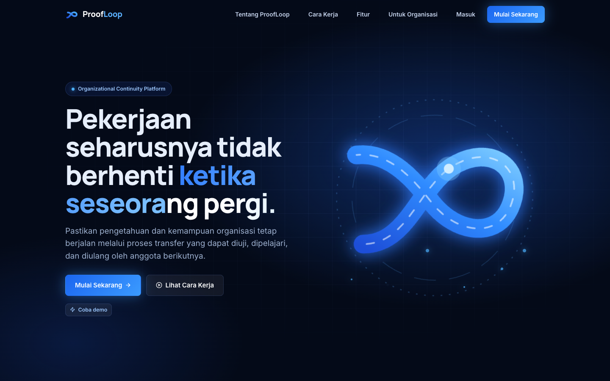
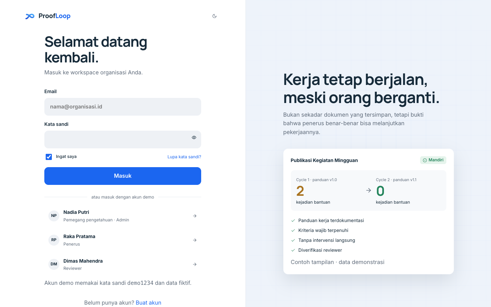
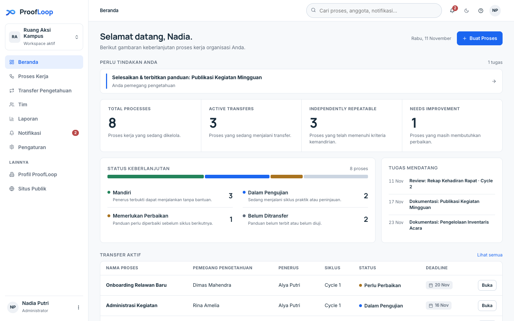
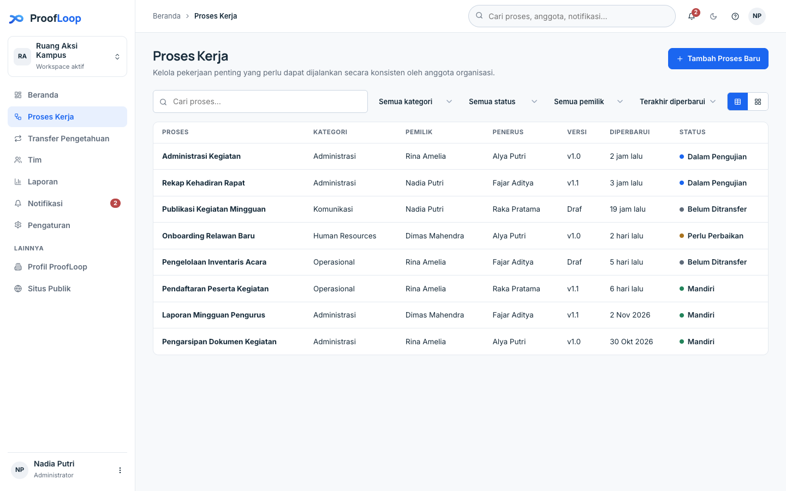
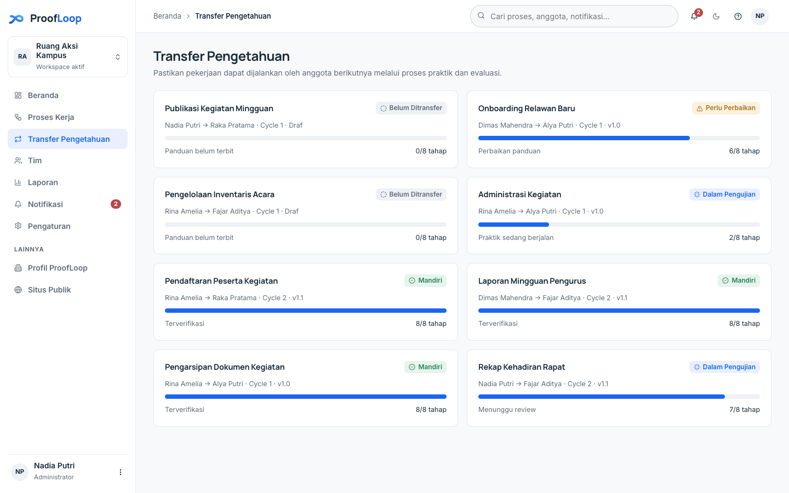
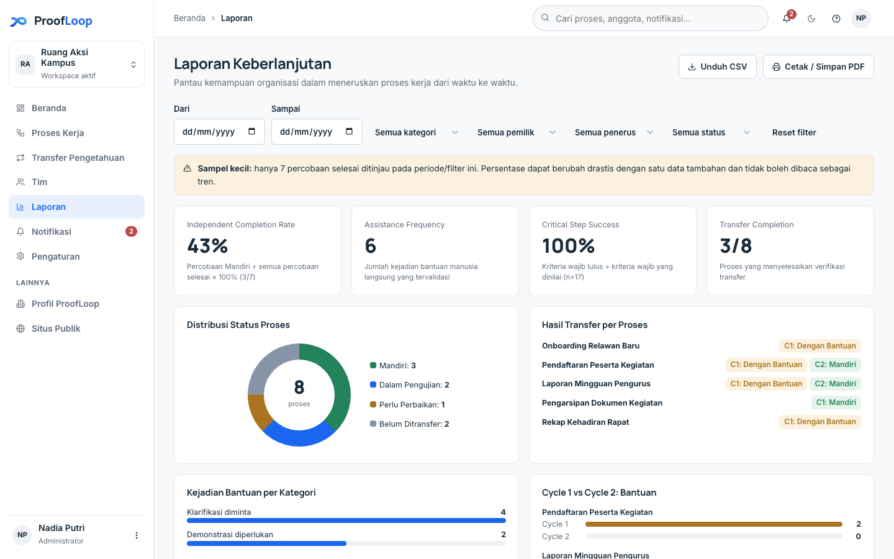
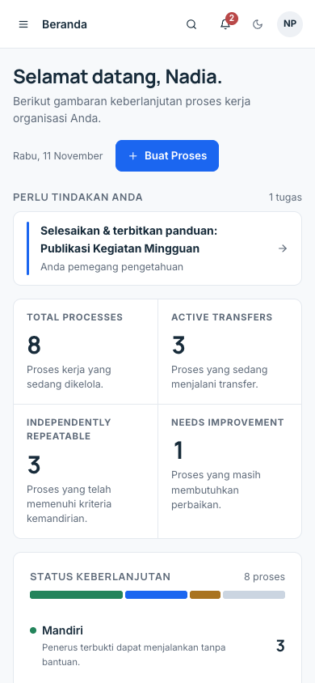

<div align="center">

# ProofLoop

### Kerja tetap berjalan, meski orang berganti.

<p>Platform keberlanjutan organisasi: bukan sekadar menyimpan dokumen, tetapi membuktikan bahwa penerus benar-benar bisa mengulang pekerjaannya.</p>

<p>   </p>
</div>

Pengetahuan yang tertulis belum tentu pengetahuan yang bisa dipakai. ProofLoop mengubah serah terima menjadi proses yang bisa diuji: pemilik menulis panduan, penerus mempraktikkannya, reviewer mengevaluasi, lalu panduan diperbaiki sampai penerus terbukti mandiri.

Prototipe tanpa server. Semua data demo fiktif dan tersimpan di peramban.

## Tampilan

| | |
| --- | --- |
| **Halaman publik**: pengantar produk dan profil perusahaan.<br> | **Masuk**: akun demo siap pakai untuk tiga peran.<br> |
| **Beranda**: status keberlanjutan semua proses dan tugas yang perlu tindakan.<br> | **Proses kerja**: daftar proses beserta pemilik, penerus, versi, dan status.<br> |
| **Transfer pengetahuan**: progres serah terima per siklus.<br> | **Laporan keberlanjutan**: tingkat kemandirian, frekuensi bantuan, dan langkah kritis.<br> |

**Ponsel**:



## Fitur

- **Dokumentasi proses**: panduan terstruktur berisi tujuan, persiapan, langkah, hasil yang berhasil, risiko, dan penanganan.
- **Serah terima terpandu**: dua siklus praktik dengan peran jelas untuk pemilik, penerus, dan reviewer.
- **Uji keterulangan**: penerus menjalankan pekerjaan nyata, bukan hanya membaca dokumen.
- **Pelacakan bantuan**: membedakan kerja mandiri dari kerja yang butuh bantuan langsung. Membaca panduan tidak dihitung sebagai bantuan.
- **Pemetaan celah pengetahuan**: setiap kendala dipetakan ke penyebabnya, sehingga yang diperbaiki adalah panduan, bukan penerusnya yang disalahkan.
- **Laporan berbasis bukti**: tingkat kemandirian, frekuensi bantuan, dan keberhasilan langkah kritis, bisa diunduh sebagai CSV atau dicetak.

## Menjalankan

Prasyarat: Node.js (atau Python 3). Tidak ada dependensi dan tidak ada build step.

```sh
npm start
```

Buka http://localhost:5173. Alternatif tanpa Node: `python3 -m http.server 8123`, lalu buka http://localhost:8123.

## Akun demo

Kata sandi semua akun: `demo1234`.

| Akun | Peran |
| --- | --- |
| `nadia@ruangaksi.id` | Pemegang pengetahuan · Admin |
| `raka@ruangaksi.id` | Penerus |
| `dimas@ruangaksi.id` | Reviewer |

Ganti peran lewat menu avatar. **Reset data demo** di menu yang sama memulihkan data awal.

## Alur demo

1. Nadia menerbitkan panduan *Publikasi Kegiatan Mingguan*.
2. Raka berlatih di Cycle 1 dan mencatat bantuan serta kendala.
3. Dimas mengevaluasi hasilnya.
4. Nadia memperbaiki panduan dan menerbitkan v1.1.
5. Raka mengulang di Cycle 2, Dimas mengevaluasi lagi.
6. Hasil dan laporan ikut diperbarui.

## Struktur

- `index.html`: titik masuk.
- `css/`: `app.css` (sistem desain aplikasi dan autentikasi), `public.css` (halaman publik).
- `js/`: `core` (router, shell, komponen), `store` (data dan localStorage), `auth` (masuk, daftar, onboarding), `public` (beranda dan profil), `pages1`–`pages3` (proses, transfer, tim, laporan, pengaturan).
- `dev-server.js`: server statis kecil tanpa dependensi.

## Batasan

- Tidak ada server: email, unggah berkas (hanya nama berkas yang disimpan), dan autentikasi nyata belum ada.
- Data tersimpan di `localStorage` (`proofloop.v1`) pada satu peramban. Izin peran bersifat informatif.
- Membuat akun baru akan membuat workspace kosong dan menggantikan data demo di peramban itu.

---

© 2026 Vassel Goleyu. All rights reserved.
